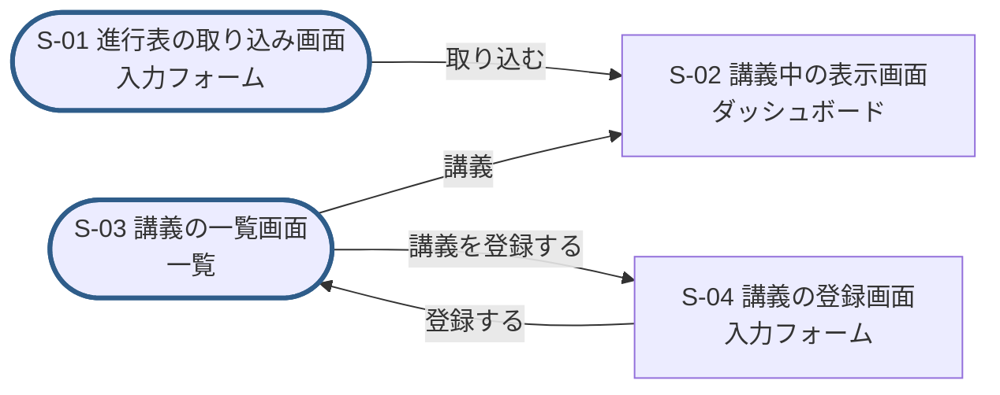

# 03 画面一覧と遷移図

## 画面一覧

### S-01 進行表の取り込み画面
- 種類：入力フォーム（入口）
- 使える役割：私
- 説明：講義進行表のテキストを貼り付けて取り込む画面
- 画面要素：
  - [入力欄] 進行表のテキスト / 機能 F-001
  - [ボタン] 取り込む / 機能 F-001 / 遷移先 S-02

### S-02 講義中の表示画面
- 種類：ダッシュボード
- 使える役割：私
- 説明：机に置いたスマホで、予定上の現在のブロックを操作せずに確かめる画面
- 画面要素：
  - [表示] 現在時刻
  - [表示] スライド範囲
  - [表示] 講義内容
  - [表示] 残り時間
  - [表示] 【休憩】

### S-03 講義の一覧画面
- 種類：一覧（入口）
- 使える役割：私
- 説明：登録した講義を日付ごとに一覧で見て、講義を始める前に表示する講義を選ぶ画面
- 画面要素：
  - [一覧] 登録した講義 / 機能 F-005
  - [選択肢] 講義 / 機能 F-006 / 遷移先 S-02
  - [ボタン] 講義を登録する / 遷移先 S-04

### S-04 講義の登録画面
- 種類：入力フォーム
- 使える役割：私
- 説明：講義ごとに、日付と進行表のテキストを事前に登録する画面
- 画面要素：
  - [入力欄] 日付 / 機能 F-004
  - [入力欄] 進行表のテキスト / 機能 F-004
  - [ボタン] 登録する / 機能 F-004 / 遷移先 S-03

## 共通部品

（まだありません）

## 画面遷移図

## 遷移の一覧
- S-01 → S-02（取り込む）
- S-03 → S-02（講義）
- S-03 → S-04（講義を登録する）
- S-04 → S-03（登録する）
