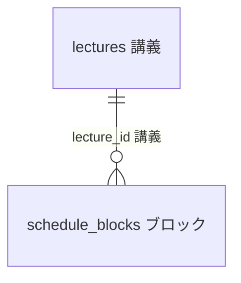

# 04 データベース設計

## テーブル定義

### TB-01 講義
- 物理名：lectures
- 説明：日付ごとに事前に登録した講義。1つの講義は日付と進行表の組
- 論理削除：なし

| カラムID | 論理名 | 物理名 | 型 | 必須 | 一意 | 既定値 | 参照先／選択肢 |
|---|---|---|---|---|---|---|---|
| TB-01-1 | 講義ID | id | 整数 | ○ | ○ |  |  |
| TB-01-2 | 日付 | lecture_date | 日付 | ○ |  |  |  |

### TB-02 ブロック
- 物理名：schedule_blocks
- 説明：講義進行表の1行。休憩の行も1つのブロックとして持つ
- 論理削除：なし

| カラムID | 論理名 | 物理名 | 型 | 必須 | 一意 | 既定値 | 参照先／選択肢 |
|---|---|---|---|---|---|---|---|
| TB-02-1 | ブロックID | id | 整数 | ○ | ○ |  |  |
| TB-02-2 | 講義 | lecture_id | 参照 | ○ |  |  | 参照先 TB-01 |
| TB-02-3 | 並び順 | sort_order | 整数 | ○ |  |  |  |
| TB-02-4 | 開始時間 | start_time | 短い文字列 | ○ |  |  |  |
| TB-02-5 | 所要時間 | duration | 短い文字列 | ○ |  |  |  |
| TB-02-6 | ステップ | step | 短い文字列 |  |  |  |  |
| TB-02-7 | 進め方・手順 | procedure | 長い文字列 |  |  |  |  |
| TB-02-8 | 使用ツール・資料 | tools_materials | 長い文字列 |  |  |  |  |
| TB-02-9 | ハマりポイント／フォロー方法 | trouble_follow_up | 長い文字列 |  |  |  |  |
| TB-02-10 | 時間調整ポイント | time_adjustment | 長い文字列 |  |  |  |  |
| TB-02-11 | 休憩 | is_break | 真偽 | ○ |  | false |  |

## ER図

## CRUD表（C=登録 R=参照 U=更新 D=削除）

| 機能 | TB-01 | TB-02 |
|---|---|---|
| F-002 現在のブロックの判定 |  | R |
| F-003 画面表示の更新 |  | R |
| F-004 講義の登録 | C | C |
| F-005 登録した講義の一覧表示 | R |  |
| F-006 講義の選択 | R | R |
